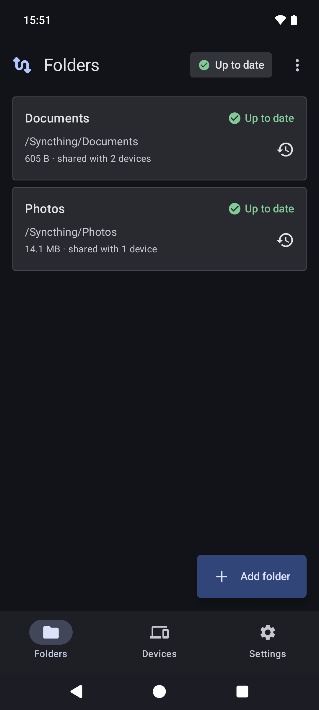
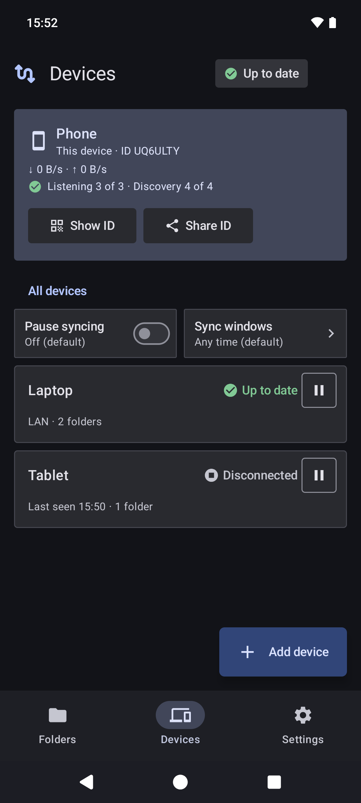
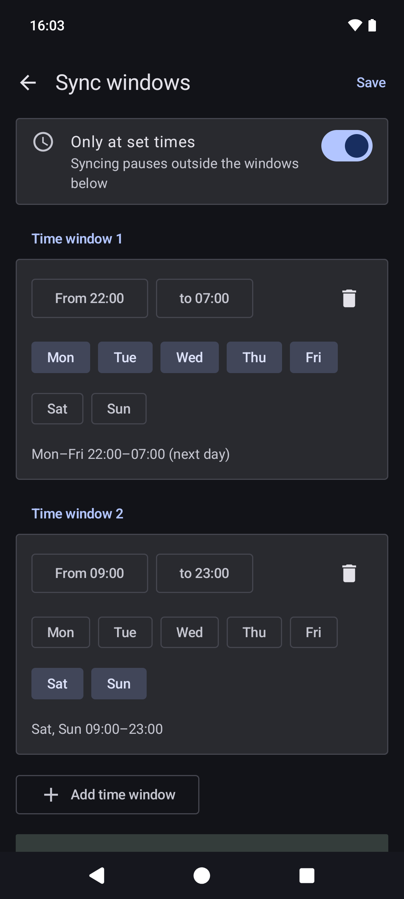
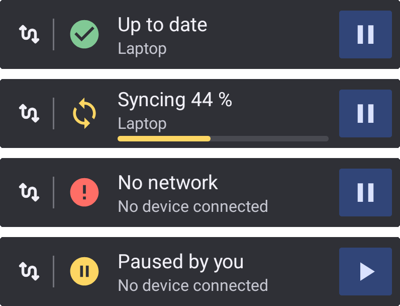
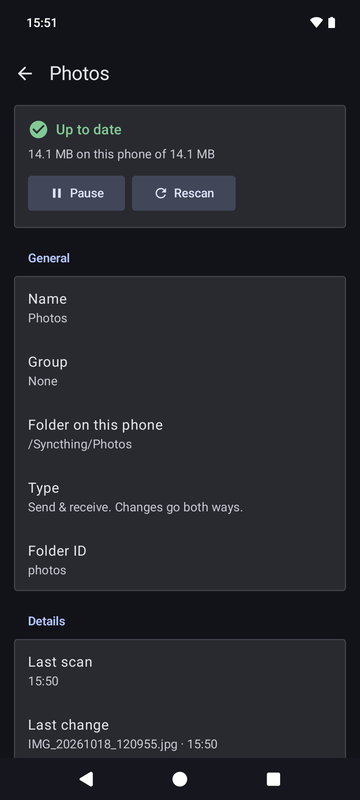
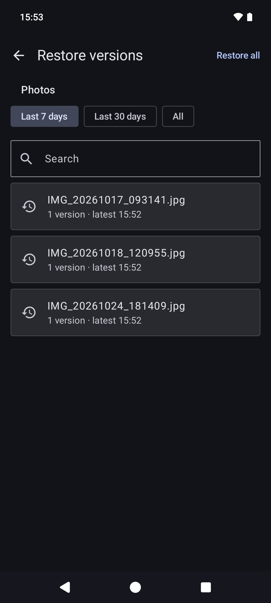
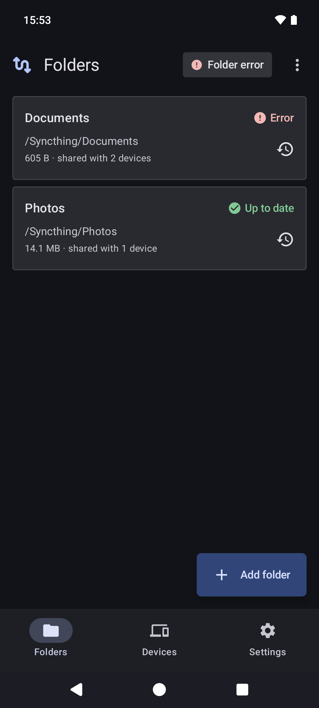
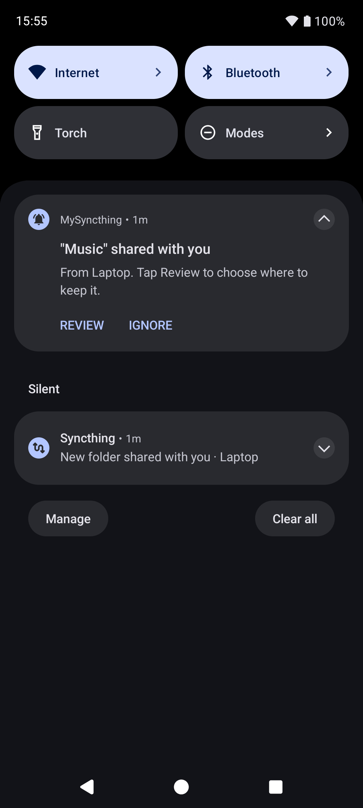

# MySyncthing

[Syncthing](https://syncthing.net) for Android 15, 16 and 17: your folders kept in sync between your devices, directly and encrypted, with no cloud service in between. MySyncthing is a new native app in Kotlin and Jetpack Compose around the official Syncthing core, not a fork of syncthing-android.

Get it from the [releases page](https://github.com/aiste633/mysyncthing/releases) (signed APK). It will be published on F-Droid once F-Droid accepts it.

MySyncthing is vibecoded: an AI coding assistant (Claude) wrote nearly all of its code, directed and tested by one person. It is tested hard (see [Testing](docs/testing.md)), but it comes with no guarantees: if something breaks or goes wrong, including lost or damaged files, that is on you, as the AGPL-3.0 (sections 15 and 16) says. Keep backups of anything that matters.

<p align="center">



</p>

## Features

### Home-screen widget

See your sync status at a glance, without opening the app. The widget is a single row like a search bar, and you can stretch it sideways. It shows whether everything is up to date, syncing (with progress), paused or needs your attention, and which devices are connected, or when one last was. Its button pauses and resumes syncing, and a tap opens the app. An amber dot on the status icon means conflict copies are waiting; a tap then opens the Folders tab. Colours and icons follow your wallpaper and dark mode.

<p align="center"></p>

### Syncing

- Folders and devices as clear cards with colour and icon status. Each folder card has a button for that folder's recent changes. Pair devices by QR code or device ID.
- Accept shared folders with a suggested location, choose the folder type, sharing and file versioning; restore older versions of a file.
- Choose where a folder goes without typing a path: one tap for the usual folders (Camera, Screenshots, Download, Documents and more), or the app's own folder browser over internal storage, SD cards and USB sticks, with New folder. It shows which folders are already synced, and it can pick Download and the top of a storage, which Android's own picker refuses. Works in work profiles and Private Space too.
- Conflicts: when two devices changed the same file, Syncthing keeps the older edit as a `.sync-conflict-` copy. The folder's card counts the copies in amber, its Recent changes lists them on top (with how many copies per file the folder keeps), and the widget shows a small amber dot. The folder still reads "Up to date", because syncing goes on.
- No device connected is a grey "Waiting for devices" for 30 minutes, and only then a red problem; devices you paused don't count.
- Connect through a SOCKS5 or HTTP proxy, such as Tor with Orbot, optionally with nothing going around it.
- Starts at boot and keeps syncing in the background; the notification says what is happening.
- Notifies you of new devices and shared folders (with Review and Ignore) and of folders that stop syncing.
- Syncthing's own web GUI is built in for the few things the app does not cover, signed in automatically and private to the app.

### Sync when it suits you

Syncing only when it suits you is also what keeps battery use low: see [Caveats](#caveats).

- Run conditions: metered Wi-Fi, mobile data and roaming each on or off; only while charging or only on battery; pause in battery saver.
- Sync windows: syncing only at set times of the week (for example 22:00–07:00 on weekdays), set on the Devices tab. Outside the windows syncing pauses, and it resumes by itself.
- Sync windows per device: a device can have its own windows, which narrow the global ones (for example the NAS only at night). The app warns of windows shorter than 1 h and refuses own windows that never overlap the global ones; the device card says "Outside its sync windows · next 22:00".
- Pause single devices from their card. Each card says why a device is paused (by you, or for example on mobile data), and a device you paused stays paused when the run conditions allow syncing again.
- The Devices tab has the switches for all devices together: pause syncing, and the sync windows. Every device card says when the device was last seen.
- New devices use one connection instead of Syncthing's usual three, which is plenty for a phone; each device can still be set to more.
- When idle, the app writes about 0.02–0.14 MB an hour to flash; it keeps no log files. Writes come from syncing itself.

### Made for Android 15, 16 and 17

- Only Android 15, 16 and 17, so nothing is held back by older versions. It runs as a foreground service of the kind Android allows to run all day, without the 6-hour daily limit of data-sync services.
- Native Material 3 screens in your wallpaper's colours (Material You), with dark mode, the home-screen widget and a themed icon.
- Works with TalkBack: every button is named and every switch and checkbox reads as on or off. Text stays readable (4.5:1) with Android's Colour contrast setting too.
- In English, Italian, Spanish, German and French, in the phone's language or one chosen for the app alone (Android's per-app language). Dates, times and numbers follow the phone's region and its 12/24 h setting. The text is in standard Android string files, ready for a translation platform such as Weblate: see [translations](docs/translations.md).
- Android 17 stops apps that use too much memory. The app gives the Syncthing core a memory limit below the phone's, by itself or with a value you set (Settings › Advanced › Core memory limit, with the live memory use): near the limit the core frees memory more often, so syncing gets slower instead of stopping.
- Uninstalling offers to keep the app's data, so that installing it again brings back the phone's identity and setup.

### Import and export

- Easy switch from Syncthing-Fork: import its backup, encrypted ones too, and take over its device ID, folders and devices. Export this app's setup and import it on another phone: strongly encrypted (Argon2id and XChaCha20-Poly1305) by default, or as a WinZip AES-256 zip that other apps open.

<p align="center">




</p>

## Security and privacy

A sync app can do more damage than most apps: a file deleted on one device is deleted on all of them. So the app keeps what other apps and the network can reach to a minimum, and it is tested hard.

### Privacy

- No tracking, advertising, analytics or crash-reporting libraries. There is no account and no server of ours: the app's developer receives nothing.
- Syncthing's anonymous usage reporting is asked once and is off unless you say yes. What it sends is described by the Syncthing project: [Security principles](https://docs.syncthing.net/users/security.html) and [data.syncthing.net](https://data.syncthing.net).
- Cloud backup is off, so the device keys never go to a cloud. Android's phone-to-phone transfer to a new phone does carry them, so the new phone keeps the old one's identity: afterwards stop Syncthing on the old phone (the app reminds you once).
- Release builds keep Syncthing's routine log lines, which name devices and folders, out of Android's system log.

Details: [privacy](docs/privacy.md): what the app keeps on the phone, what goes to Syncthing's public servers and how to turn each off, permissions, your rights under the GDPR.

### Hardening

- The app talks to its Syncthing core only inside the phone, over TLS that trusts only the core's own certificate, with an API key. The key and the web GUI's login are new at every start, and the old ones stop working. The app keeps them only in memory; Syncthing's configuration, in the app's private storage, holds the key and the password's hash until the next start replaces them.
- The web GUI is protected by a random 64-character user and password that only the app knows, because other apps on the phone can reach the same address; the core refuses any change to them. The built-in web view loads only the core's own address and nothing else.
- Of the app's own parts, other apps can open only its main screen. A list of every permission and every part other apps can reach, libraries included, is kept in the repository, and CI fails when it changes.
- Imported backups are untrusted input: settings that could run a command, delete files outside the folder, reach the app's own files or report to other servers are taken out and listed before you import, and a backup changed after its preview is refused.
- Every input field is checked against the Syncthing core's own rules and has a length limit, in the form, again before it reaches the core, and in imports; [input validation](docs/input-validation.md).
- A shown password hides the screen from screenshots and screen recordings, and password fields always ask for a password keyboard.
- Notifications about new devices and folders show no addresses, and on the lock screen no names.
- Exported setups are encrypted by default (Argon2id and XChaCha20-Poly1305).

Found a security problem? Report it privately: [security policy](SECURITY.md).

### Tested

What each test covers and what it found, with its numbers: [testing and hardening](docs/testing.md).

- Property tests of 20,000 random inputs for each input field, and Go fuzzing of everything that reaches the core or reads a file from outside; it found and fixed a bug in Syncthing itself.
- A security audit and a gap analysis against common practice, and a review of the whole project in November 2026.
- Stress tests (50,000 files, full storage, random UI events), a 10-hour memory soak with no leak, flash-write tracing, and interruption tests (rotation, Android reclaiming the app, permissions taken away).
- Emulator end-to-end tests on Android 15, 16 and 17 against a real Syncthing peer run on the maintainer's PC before every merge; each release commits their results in [`docs/e2e/`](docs/e2e/), and CI refuses a release tag without them.
- CI checks every pull request, and `main` after each merge: unit tests, lint, a leak check that keeps personal details out of the repository and its history, a guard on the app's permissions, an audit of the workflows, and a twin build that must be byte-identical. CodeQL analyses the app and the core. A daily scan opens an issue when a vulnerability is published that affects the app: in its Go code, its libraries (the SBOM) or the pinned actions. A monthly check lists newer releases of everything the build pins and watches that F-Droid keeps up with each release. GitHub Actions are pinned by commit hash, and releases carry a signed build provenance attestation.

### Free and verifiable

- Free software: MySyncthing is AGPL-3.0-or-later, the Syncthing core MPL-2.0, and every other part of the APK has a free software licence too. The SBOM check in CI refuses any other licence (see [Licence](#licence)).
- The official Syncthing core (v2), unchanged apart from a few small fixes, each documented in [`go/patches/`](go/patches/).
- Reproducible builds: every build of a release gives a byte-identical APK, so anyone, F-Droid included, can check that a release APK was built from this source.
- A [software bill of materials](docs/sbom.md) lists everything the APK contains, with versions and licences; CI keeps it current.

### Verify a release

Build the tag and check that the release APK is that build plus our signature. Needs the [Build](docs/development.md#build) requirements, a recent `gh` that is logged in, and `apksigcopier` (Debian: `apt install apksigcopier`; it calls `apksigner` from build-tools):

```sh
v=X.Y.Z   # the version to check, for example 0.5.0
git clone --branch "v$v" --recurse-submodules https://github.com/aiste633/mysyncthing && cd mysyncthing
./gradlew :app:assembleRelease
unsigned=app/build/outputs/apk/release/app-release-unsigned.apk
gh attestation verify "$unsigned" --repo aiste633/mysyncthing   # GitHub built these exact bytes from the tag
gh release download "v$v" --pattern "mysyncthing-$v.apk"
apksigcopier compare "mysyncthing-$v.apk" --unsigned "$unsigned" && echo "same build"
```

## Caveats

- **Battery.** Despite our best optimisation efforts, we suggest you make aggressive use of scheduling to keep battery use low: the [sync windows](#sync-when-it-suits-you) on the Devices tab, each device's own windows, and the run conditions in Settings (for example only on unmetered Wi-Fi and only while charging). The reason is the core. It is the official Syncthing, written for computers, and it has not been reimplemented and optimised for mobile from the ground up: that would be a huge effort and an expensive Claude bill. It is not out of the question in the future. Outside the windows syncing stops, which is most of the work, but the core stays up to listen and to be found, so scheduling lowers battery use without bringing it to zero. The app holds no wakelock, so a sleeping phone wakes only for incoming traffic. Battery use has not been measured in mAh: on a phone in use, other apps swamp the app's share ([what was measured](docs/testing.md#flash-writes-2026-10-26)).
- **Android 15, 16 and 17, 64-bit ARM only.** There is no build for older Android versions or for other processors.
- **Not on F-Droid yet.** Until F-Droid accepts the app, updates are a new APK from the releases page, installed by hand.

## Development

The app is three parts: `app/` (the Compose screens), `core/` (the foreground service, run conditions and the client for the core's REST API) and `go/` (the bridge that runs the official Syncthing in the app's process, built with gomobile, and our few patches to it).

```sh
git submodule update --init
./gradlew :app:assembleDebug   # on Linux, with JDK 21, Go, the Android SDK (platform 37) and the NDK pinned in gradle.properties
```

- [Development](docs/development.md): layout, build, tests, the security checks in CI, updating Syncthing, keeping everything up to date, the software bill of materials.
- [Reproducible builds and releases](docs/releasing.md): what keeps builds byte-identical, the steps of a release, the F-Droid recipe.
- [Testing and hardening](docs/testing.md), [input validation](docs/input-validation.md), [translations](docs/translations.md), [developer notes](docs/dev-notes.md).

## Licence

AGPL-3.0-or-later: the GNU Affero General Public License version 3 (see `LICENSE`), or at your option any later version. The bundled Syncthing core is MPL-2.0.

Everything the release APK contains, with versions and licences, is in the [software bill of materials](docs/sbom.md).
