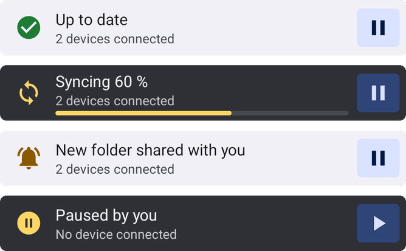
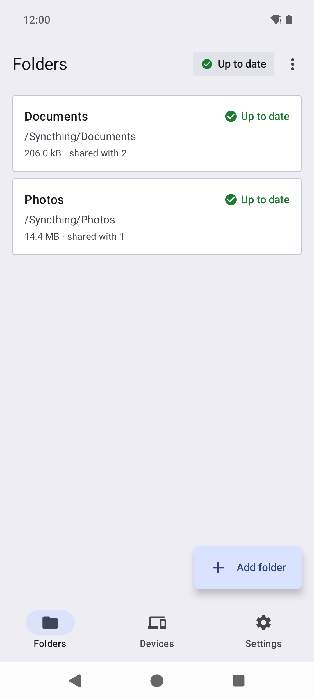
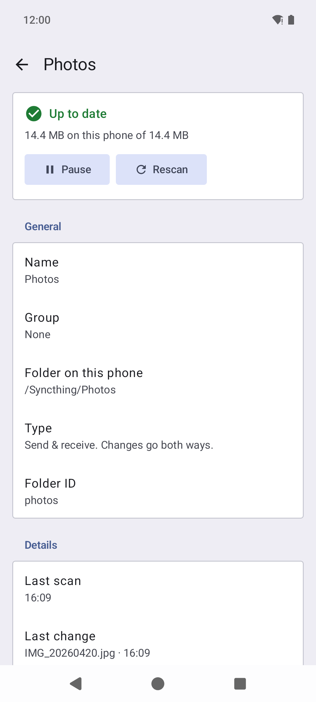
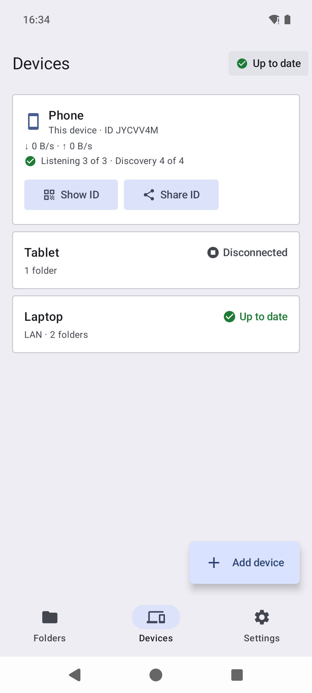
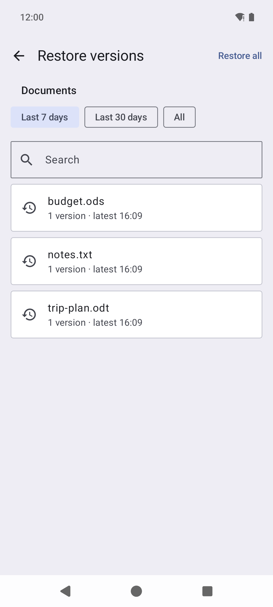
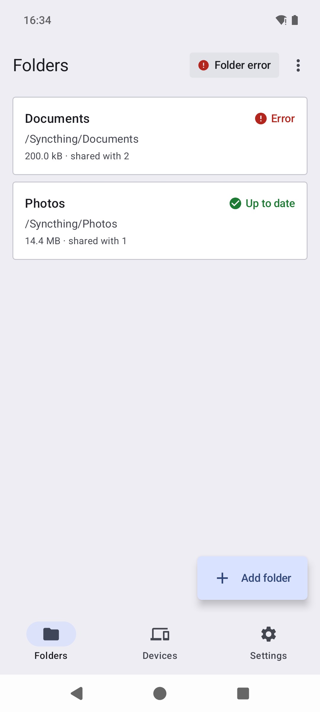
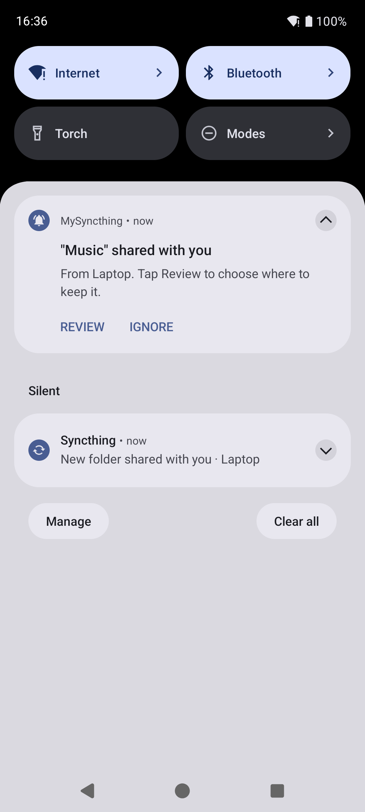

# MySyncthing

A Syncthing client for Android 15 and 16 (API 35/36), written in Kotlin and Jetpack Compose. It is a new app, not a fork of syncthing-android. It will be published on F-Droid; there is no release date yet.

## Home-screen widget

See your sync status at a glance, without opening the app. The widget is a single row like a search bar, and you can stretch it sideways. It shows whether everything is up to date, syncing (with progress), paused or needs your attention, and which devices are connected. Its button pauses and resumes syncing, and a tap opens the app. Colours and icons follow your wallpaper and dark mode.

<p align="center"></p>

## Features

- Folders and devices as clear cards with colour and icon status, in Material You colours and dark mode.
- Accept shared folders with a suggested location, choose the folder type, sharing and file versioning.
- Run conditions: metered Wi-Fi, mobile data and roaming each on or off; only while charging or only on battery; pause in battery saver; only at set times of the week (for example 22:00–07:00 on weekdays).
- Connect through a SOCKS5 or HTTP proxy, such as Tor with Orbot, optionally with nothing going around it.
- Export the setup to a zip, optionally AES-256 encrypted, and import it, or a Syncthing-Fork backup, on another phone.
- Starts at boot and keeps syncing in the background; the notification says what is happening.
- Notifies you of new devices and shared folders (with Review and Ignore) and of folders that stop syncing.
- In English and Italian, in the phone's language or one chosen for the app alone (Android's per-app language). Dates, times and numbers follow the phone's region and its 12/24 h setting. More languages can be added without code changes: see [Translations](#translations).
- Works with TalkBack: every button is named and every switch and checkbox reads as on or off.
- Syncthing's own web GUI is built in for anything the app does not cover, signed in automatically and private to the app.
- Reproducible builds: every build of a release gives a byte-identical APK, so anyone can check that a release APK was built from this source.
- No tracking: no analytics or crash-reporting libraries. Syncthing's anonymous usage reporting is asked once and is off unless you say yes. What the app keeps and what leaves the phone: [privacy](docs/privacy.md).

## Screenshots

<p align="center">



</p>
<p align="center">



</p>

## Layout

| Path | What |
|---|---|
| `app/` | Compose UI: folders, devices (QR pairing), settings, upstream web GUI as fallback |
| `core/` | `specialUse` foreground service, run conditions, REST/event client |
| `go/bridge/` | Go package `stbridge`; runs Syncthing in-process, exposes start/stop/identity |
| `go/syncthing/` | Upstream Syncthing, git submodule pinned to a release tag |
| `go/patches/` | Our fixes to upstream Syncthing, applied to the submodule by `go/patch.sh` at build time |

The Go core is built into `go/build/stbridge.aar` with gomobile. Kotlin talks to it only through Syncthing's REST API on `127.0.0.1:<random port>`, authenticated with a per-install API key. The web GUI is protected by a random 64-character user and password that only the app knows, because other apps can reach loopback; the core refuses any change to them.

## Build

Requirements: JDK 21, Go (the toolchain auto-downloads the version upstream needs), Android SDK 36, and the NDK version pinned in `gradle.properties` (`mysyncthing.ndkVersion`; `sdkmanager "ndk;<version>"`).

```sh
git submodule update --init
./gradlew :app:assembleDebug   # runs go/build.sh first; :core alone cannot be bundled as an AAR
```

`cd go/bridge && go test .` starts and stops the real core on the host. Run `go/patch.sh` and then `go generate ./lib/api/auto` in `go/syncthing` once first.

`go/build.sh` applies `go/patches/*.patch` to the submodule (`go/patch.sh`, idempotent), so the submodule shows as modified after a build. Each patch is a fix we also report upstream; drop it once a Syncthing release has it. To change one, commit the change in the submodule and export it with `git format-patch -1 --no-signature --zero-commit -o ../patches/`, then check out the pinned commit again.

## Security checks

- `docs/manifest-surface.txt` lists every permission the release app has and every part of it other apps can reach, from the merged release manifest with all libraries. The `android` CI job fails when it changes, so a library that adds a permission or an exported component is seen in review. After an intended change: `./gradlew :app:processReleaseManifest && scripts/manifest-surface.py`, and commit the result.
- CodeQL (`.github/workflows/codeql.yml`) analyses the Kotlin app, the Go bridge with the patched core, the workflows and the scripts, from a real build, on every push to `main`, weekly and by hand. Findings are under Security › Code scanning. It needs the repository's CodeQL setting on "Advanced".
- zizmor lints the workflows (`workflows` job in `build.yml`): script injection, credentials kept in the checkout, permissions, and that each pinned action commit belongs to its action. Its version and wheel checksum are in `scripts/zizmor-requirements.txt`. Checkouts never keep the job's token (`persist-credentials: false`).

## Reproducible builds and releases

Every build of a commit gives a byte-identical unsigned release APK (arm64 only; debug builds also carry x86_64). This is what lets F-Droid ship the APK signed with our key. What keeps it that way:

- Toolchains are pinned in one place each: NDK in `gradle.properties`, Go in `go/syncthing/go.mod`, Gradle in the wrapper (with checksum), JDK 21 via `jvmToolchain`.
- `go/build.sh` strips paths, build IDs and timestamps from the Go library, and builds through the fixed symlink `/tmp/mysyncthing-go`, because gomobile records module paths.
- `gradle/verification-metadata.xml` holds SHA-256 checksums of every Gradle dependency. After changing a dependency or plugin version, refresh it:

  ```sh
  ./gradlew --write-verification-metadata sha256 --no-configuration-cache -I scripts/sbom/runtime-deps.init.gradle.kts \
    :app:assembleRelease :app:assembleDebug testDebugUnitTest :app:lintDebug :app:sbomRuntimeDeps
  scripts/sbom.sh
  ```

  The `sbomRuntimeDeps` part adds the POMs the SBOM reads licences from; `scripts/sbom.sh` then updates the SBOM (see [Licence](#licence)).

- GitHub Actions are pinned by full commit hash, with the version in a comment, so a moved tag cannot change what CI runs. To bump one: `git ls-remote --tags https://github.com/<owner>/<action> 'v*'`, take the commit of the new release (the `^{}` line for an annotated tag), and check that its `action.yml` says `using: node24` or later.
- CI (`.github/workflows/reproducible.yml`) builds the release APK twice, with different paths, time zones, locales and umasks, and fails if the bytes differ (a diffoscope report is attached). On pull requests, tags and manual runs, F-Droid's build image builds it a third time from the recipe in `fdroid/` and must match too.

Releasing:

1. Bump `versionCode` and `versionName` in `app/build.gradle.kts`, and add `fastlane/metadata/android/en-US/changelogs/<versionCode>.txt`.
2. Tag and push: `git tag v0.1.0 && git push origin v0.1.0`. CI creates a draft release with `mysyncthing-0.1.0-unsigned.apk` and its SBOM, `mysyncthing-0.1.0-sbom.cdx.json`, and signed build provenance (SLSA) for both: which workflow run, commit and runner made them. Anyone can check a file with `gh attestation verify <file> --repo aiste633/mysyncthing`.
3. On your machine: `KEYSTORE=~/keys/mysyncthing.jks scripts/sign-release.sh v0.1.0`, then publish the draft.

F-Droid: `fdroid/eu.stedb.mysyncthing.yml` is the draft recipe for fdroiddata. It has not been submitted, and when it will be is not decided yet.

## Updating Syncthing

```sh
cd go/syncthing && git checkout . && git clean -fd lib && git fetch --tags && git checkout vX.Y.Z
echo vX.Y.Z > ../syncthing.version
../patch.sh   # a patch that no longer applies: drop it if the release has the fix, else rebase it
cd ../bridge && go mod tidy && go test .
```

## Privacy and security

- [Privacy](docs/privacy.md): what the app keeps on the phone, what goes to Syncthing's public servers and how to turn each off, permissions, your rights under the GDPR.
- [Security policy](SECURITY.md): report a vulnerability privately through GitHub, never in a public issue.

## Translations

All text for people is in string resources; English is the source language and Italian the first translation. Files, conventions for translators, and how code handles text: [`docs/translations.md`](docs/translations.md).

## Licence

AGPL-3.0 (see `LICENSE`). The bundled Syncthing core is MPL-2.0.

Everything the release APK contains, with versions and licences, is in the software bill of materials: [`docs/sbom.md`](docs/sbom.md), and [`docs/sbom.cdx.json`](docs/sbom.cdx.json) in CycloneDX 1.6 with checksums and the dependency graph. It covers the Android and Kotlin libraries, the Go modules linked into the core, C code they bundle, the third-party files in Syncthing's web GUI, and the pinned build tools.

`scripts/sbom.sh` generates both files from the build itself: Gradle's resolved release classpath (licences from the POMs, checksums from `gradle/verification-metadata.xml`), `go list` with the core's build settings (licences read from each module's licence files), and `scripts/sbom/webgui.json` for the web GUI, whose files are pinned by checksum. It fails on anything it cannot place: a licence it has not seen before, C code in a new Go package, a web GUI file in no entry or changed. CI keeps it current: the `sbom` job in `build.yml` regenerates it and fails when the committed files differ, and the release build checks the Go modules against the build info in the APK's `libgojni.so`. After a dependency, Syncthing or toolchain change, run `scripts/sbom.sh` and commit the result.
